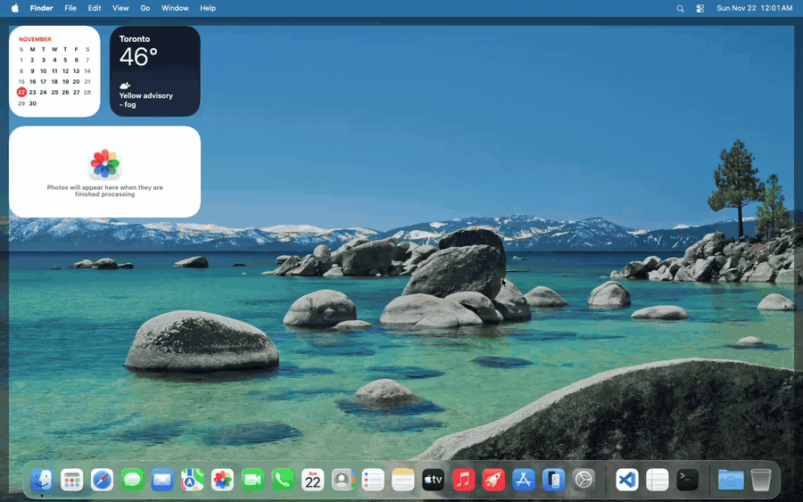

# kiosk-lock-mac

Lock your Mac to one website until a timer runs out.

It covers every display, hides the Dock and menu bar, blocks app switching and Force Quit, and only lets you navigate to the sites you allow. The only early exit is a password you hand to a friend. Kill the process and it comes back within seconds.

Good for: finishing an assignment in Google Docs, a LeetCode session, studying from one course site, or making a "work laptop" mode that a friend controls.



*The lock in action: a wrong password is rejected, the friend's password unlocks it. ([MP4](docs/demo.mp4))*

## Try it

You need Python 3 with PyObjC:

```bash
python3 -m pip install pyobjc-framework-Cocoa pyobjc-framework-WebKit pyobjc-framework-Quartz
```

See the real lock for 20 seconds. It releases itself and saves nothing:

```bash
python3 -m kiosklock lock https://en.wikipedia.org --test 20
```

## Use

1. **Have your friend set the password.** Don't watch. Only a scrypt hash is saved.
   ```bash
   python3 -m kiosklock set-password
   ```
2. **Install the agent** so a lock survives being killed and comes back after a restart:
   ```bash
   python3 -m kiosklock install
   ```
3. **Lock:**
   ```bash
   python3 -m kiosklock lock https://docs.google.com --minutes 50 --message "Finish the essay"
   python3 -m kiosklock lock https://leetcode.com --until 17:00 --allow leetcode.com github.com
   ```

`--allow` lists the sites you can go to; subdomains count, so `google.com` also allows `docs.google.com`. If you leave it out, only the starting site is allowed. Pages still load their own images and scripts from anywhere; only where you can *go* is limited.

`python3 -m kiosklock status` shows what's running.

## How it works

| What you might try | What happens |
|---|---|
| Cmd-Q, Cmd-W, Cmd-H, Cmd-M, Cmd-Tab | swallowed |
| Force Quit (Cmd-Opt-Esc), app switching | disabled while locked |
| Clicking a link to another site | blocked unless it's on the allowed list |
| `kill` | ignored |
| `kill -9` | the LaunchAgent restarts it within a few seconds |
| Logging out or restarting | the lock comes back at login until the time is up |
| Powering off | always works, on purpose |

When the time is up or the password is entered, the lock clears itself and the agent stays quiet until the next `lock`.

Without the next step you can still undo all of this yourself (`launchctl bootout`, deleting the plist). [HARDENING.md](HARDENING.md) is for your friend: it makes the agent root-owned and takes away your admin rights, which is what turns it into a real lock.

## Use it in your own app

`LockScreen` works without the CLI:

```python
from kiosklock.lockscreen import LockScreen

screen = LockScreen(["leetcode.com"], on_message=lambda msg: print(msg))
screen.show("https://leetcode.com", sidebar_html="<h1>Your HTML here</h1>")
# The sidebar can call window.webkit.messageHandlers.kiosklock.postMessage({...})
```

Run it inside an AppKit event loop (`PyObjCTools.AppHelper.runEventLoop()`). See `kiosklock/app.py` for a full example.

## Requirements

- macOS 13 or newer
- Python 3.9+ with PyObjC

## Tests

```bash
python3 -m unittest
```

## License

MIT
